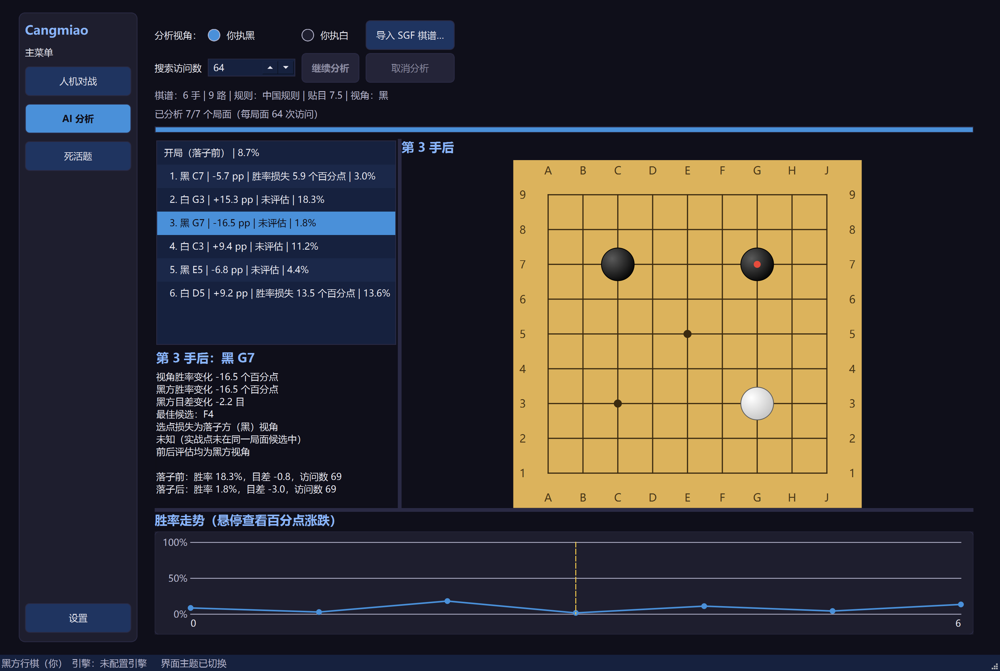
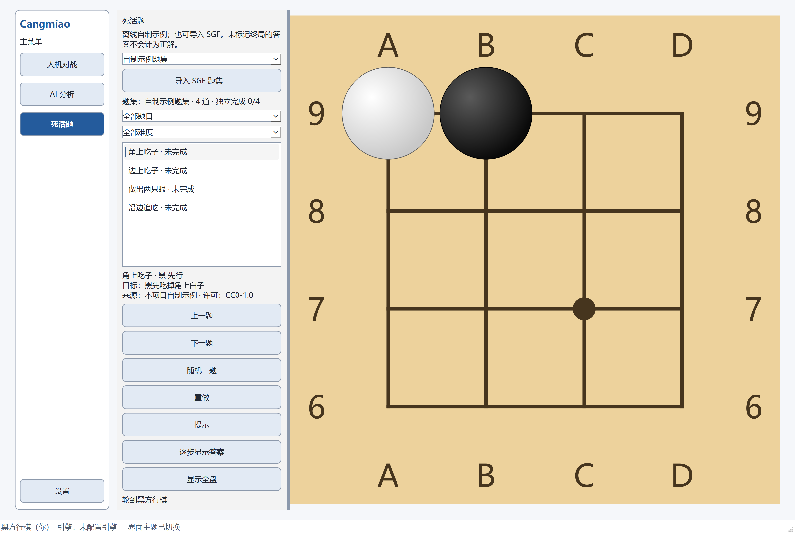
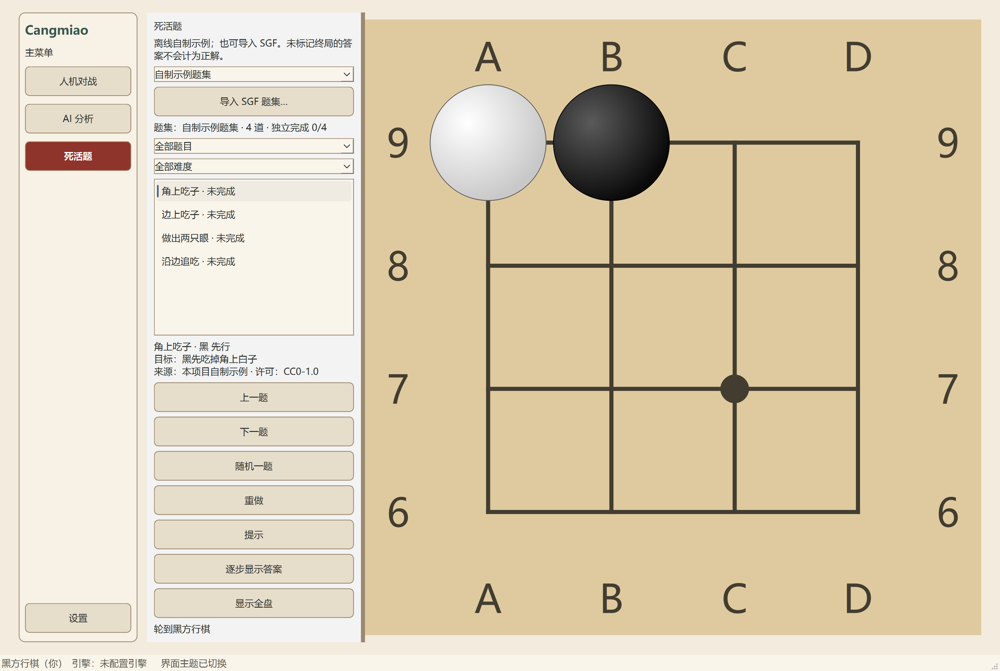
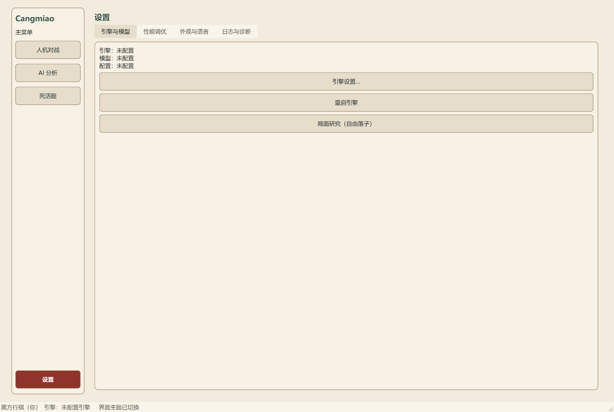

# Cangmiao — 本地围棋人机对弈

基于 Python + PySide6 的 Windows 桌面围棋应用。KataGo 作为独立本地进程运行。左侧主菜单提供“人机对战”“AI 分析”“死活题”和“设置”，不再显示应用顶部菜单或全局工具栏；系统标题栏保留。对战时在新建棋局中选色，复盘时先选择自己执黑或执白再导入 SGF。功能：

- 9 / 13 / 19 路对局，可执黑或执白（执白时 AI 先行），支持中国/日本/韩国/AGA/新西兰/Tromp-Taylor 规则和自定义贴目
- AI 强度预设（快速/标准/较强/最强），以访问数与时间上限控制 AI 对弈的搜索，不对应固定段位（AI 分析不受预设限制）
- 悔棋、停一手、认输、双方停一手后自动计分
- AI 分析编辑：用户可按顺序操作黑白双方，不触发 AI 自动应手；分析开启后持续运行，落子后自动分析新局面，直到手动停止；引擎持续更新 30 个候选点评估（合法着法不足时返回实际数量），界面按胜率显示前 10 项，并以颜色区分最优解（绿）、本手（黄）与普通候选（蓝）；显示黑白胜率、目差、访问数、用时与 NPS，选中候选可预览变化
- 整盘复盘：左侧逐手分析、中央棋盘、底部胜率曲线；查看选点优劣、实战与推荐、胜率百分点变化、目差变化、选点损失及搜索样本。分析可暂停、继续，结果缓存到本地
- 死活题：离线自制示例、SGF 题集导入、正误/未知答案区分、提示和逐步答案、错题重练及本地进度；不内置授权不明确的第三方题库
- 深色、浅色、国风三种主题，在“设置 → 外观与语言”立即切换并保存
- 本地 KataGo 一键调优：检测引擎能力、比较线程配置、验证候选配置和恢复旧配置；不降低搜索预算，不承诺每台设备都加速
- SGF 打开/保存（UTF-8，兼容 GB18030 编码的棋谱）

## 0. 安装包（CPU 版，开箱即用）

运行 `dist\Cangmiao-0.2.2-Tiny-CPU-Setup.exe` 可安装 Tiny 版。它内置 KataGo v1.18.1 通用 CPU 引擎和官方 b10c384 模型（10 个网络块），无须 AVX2 或联网；相较标准 CPU 版不包含 AVX2 引擎，适合优先控制下载和安装体积的场景。Tiny 使用独立安装标识，可与标准版并存，并使用独立设置目录 `%LOCALAPPDATA%\CangmiaoTiny`，不会覆盖标准版已有配置。默认按当前用户安装，不需要管理员权限，可在开始菜单打开或卸载。模型 SHA-256 和上游网络许可随包附带，见安装目录中的 `engine\MODEL-NOTICE.txt`。这是 KataGo 已发布的预训练模型，不是 Cangmiao 训练出的模型；“b10”指 10 个网络块，不是 10 billion 参数。

CUDA 版可运行 `dist\Cangmiao-0.2.4-CUDA-Setup.exe` 安装，针对 NVIDIA GPU，内置官方 KataGo v1.18.2 CUDA 12.5 / cuDNN 9.8 引擎和 b18c384 模型。安装包同时内置 NVIDIA 可再分发的 cuBLAS 12.5、NVRTC 12.5 和 cuDNN 9.8 DLL（与 `katago.exe` 同目录），**只需 NVIDIA 显卡和支持 CUDA 12.5 的驱动**，无需安装 CUDA Toolkit 或 cuDNN，也无需修改 `PATH`。CUDA 版使用独立安装标识和 `%LOCALAPPDATA%\CangmiaoCUDA` 设置目录，可与 CPU/Tiny 版并存。CUDA 不可用或不满足依赖时，可使用标准版 CPU/OpenCL 引擎。随包 `engine\CUDA-NOTICE.txt` 提供依赖、校验和及许可信息。

0.2.4 包含本轮五项界面与功能升级。264 项常规测试通过、12 项可选真实引擎测试跳过；另外完成真实 CPU/CUDA 调优、CUDA 复盘/缓存恢复及隔离安装验收。`dist\Cangmiao-0.2.4-CUDA.zip` 包含安装程序、项目记录和 CUDA 许可说明，并非便携版。本轮未构建 0.2.4 CPU/Tiny 安装包；OpenCL 调优未实测。发布状态见 [GitHub Releases](https://github.com/mdluffy1981/CangmiaoGO/releases)。

标准 CPU 版使用 KataGo v1.18.1 AVX2 与通用 CPU 引擎及 b18c384 模型。构建出的完整安装程序和 ZIP 位于 `dist\`；构建前可按下列命令生成相应版本。

构建安装包（需 PyInstaller 与 Inno Setup 6）：

```powershell
.\.venv\Scripts\python -m pip install pyinstaller
winget install JRSoftware.InnoSetup
.\.venv\Scripts\python packaging\build_installer.py   # --skip-test 跳过引擎自检；--no-installer 只生成程序目录
.\.venv\Scripts\python packaging\build_installer.py --tiny # Tiny：通用 CPU + b10c384
.\.venv\Scripts\python packaging\build_installer.py --cuda # CUDA：NVIDIA GPU，内置 CUDA 12.5/cuDNN 9 运行库
```

构建脚本会把引擎、模型和中文安装向导翻译下载到 `build\cache`（均校验 SHA-256），用 PyInstaller 打包到 `build\pyi-dist\Cangmiao`，再把引擎放进其中的 `engine\` 目录并执行 GTP 自检。标准版生成 `Cangmiao-<版本>-CPU-Setup.exe` 和 ZIP；Tiny 使用 `--tiny`，只捆绑通用 CPU 引擎和官方 b10c384 模型；CUDA 使用 `--cuda`，捆绑官方 NVIDIA CUDA 引擎、b18c384 模型，以及从 NVIDIA redist 下载并校验的 cuBLAS/NVRTC/cuDNN DLL 和许可文件（`engine\cuda\NVIDIA-LICENSES`），自检环境只需 NVIDIA 显卡和驱动。两个变体生成各自独立的安装程序和设置目录。ZIP 包含安装程序、项目记录和对应网络/运行库声明，并校验完整性。

## 1. 环境要求（从源码运行）

- Windows 10/11 64 位
- Python 3.10 及以上（已在 3.14 上测试）
- GPU 版需要显卡驱动。CUDA 版使用 NVIDIA GPU（CUDA 12.5/cuDNN 9）；OpenCL 版也支持 NVIDIA/AMD/Intel GPU。没有可用 GPU 时可显式选择 CPU 版

## 2. 安装应用

```powershell
cd <项目目录>
python -m venv .venv
.\.venv\Scripts\python -m pip install -e ".[test]"
```

## 3. 准备 KataGo 引擎、模型与配置

### 自动安装（推荐）

```powershell
.\.venv\Scripts\python -m katago_gui.setup_engine                       # GPU（OpenCL，默认）
.\.venv\Scripts\python -m katago_gui.setup_engine --backend cuda        # NVIDIA CUDA（自动下载 CUDA/cuDNN 运行库，约 1.2 GB）
.\.venv\Scripts\python -m katago_gui.setup_engine --backend eigenavx2   # 仅 CPU（需支持 AVX2）
.\.venv\Scripts\python -m katago_gui.setup_engine --backend eigen       # 仅 CPU（通用，最慢）
```

脚本会：

1. 下载所选 KataGo Windows 后端和模型 `kata1-b18c384nbt-s9996604416-d4316597426.bin.gz`（约 93 MB），并用固定的 SHA-256 校验；CUDA 使用 v1.18.2 / CUDA 12.5 / cuDNN 9.8 的官方构建，并下载 NVIDIA cuBLAS、NVRTC、cuDNN 运行库放到 `katago.exe` 同目录；
2. 解压到 `%LOCALAPPDATA%\KataGoDesktop\engine\<backend>\`，把 `default_gtp.cfg` 复制为 `engine\gtp.cfg`（已存在则保留）；
3. 运行 `katago version` 和一次 GTP 自检。**OpenCL 首次运行会对显卡调优，可能需要几分钟**；
4. 把三个路径写入 `%LOCALAPPDATA%\KataGoDesktop\settings.json`。

GPU 版失败时脚本会报错退出，**不会自动改用 CPU**；CUDA 版需要支持 CUDA 12.5 的 NVIDIA 驱动。请检查驱动，或显式加 `--backend opencl`、`--backend eigenavx2`。

下载中断会保留 `.part` 文件，重新运行可续传；校验通过的文件不会重复下载。安装包来自 KataGo 官方发布，模型来自 KataGo Training；使用与再分发请遵守各自的许可条款。

其他选项：`--dest DIR` 指定安装目录；`--katago`、`--model`、`--config` 使用已有文件；`--skip-test` 跳过自检。

### 手动安装

1. 从 <https://github.com/lightvector/KataGo/releases> 下载 Windows 版（`opencl` 或 `eigenavx2`）并解压；
2. 从 <https://katagotraining.org/networks/> 下载模型（`.bin.gz`）；
3. 使用压缩包中的 `default_gtp.cfg` 作为配置（可修改 `numSearchThreads` 等）；
4. 启动应用后在左侧“设置 → 引擎与模型 → 引擎设置”中填入三个路径。

应用启动 KataGo 时会附加 `-override-config reportAnalysisWinratesAs=SIDETOMOVE,ponderingEnabled=false`，通过 `kata-set-param` 应用对局预算。多线程搜索与停止确认有少量开销，访问数可能略超阈值；预设不是硬实时保证或固定段位。

“设置 → 引擎与模型 → 局面研究（自由落子）”保留实时分析功能，使用 `kata-analyze <颜色> 20 maxmoves 30 minmoves 30 rootInfo true`（每 0.2 秒刷新）。它不设访问数或时间上限，会一直搜索到停止或切换模式；落子后自动继续。收起右栏不会停止分析，可先展开右栏再停止。`minmoves` 与 `maxmoves` 控制报告数量，不限制搜索树只探索 30 个着法；访问数为 0 的候选是模型初始评估。长时间搜索占用更多内存。候选按当前行棋方胜率排序取前 10 项：第 1 名为最优解，与最优解胜率差 ≤ 2 个百分点且目差差距 ≤ 1 目的为本手，其余为普通候选。整盘复盘使用独立的受控搜索预算，不沿用此无限搜索模式。

分析模式右栏采用紧凑按钮与单行指标布局；在 1280×860、1366×768 窗口下可完整显示十行候选，无需向下滚动。更窄的窗口仍保留纵向布局与滚动，以免遮挡内容。

0.1.1 保留引擎实时胜率，不隐藏、不平均，也不沿用上一局面的数值。局面访问数不足 64 时，黑白胜率标注 `*`；候选访问数不足 16 时，该候选胜率也标注 `*`，并显示“低样本，胜率易波动”提示，悬停可查看说明。访问数为 0 的候选会明确说明尚未搜索。这些阈值仅用于提示，不代表统计置信度或保证后续胜率稳定；落子、悔棋或重新分析时根据新报告重新判断，搜索充分后自动移除相应标记，停止分析后保留最后报告的提示。

## 4. 启动

```powershell
.\.venv\Scripts\cangmiao.exe                # 或：.\.venv\Scripts\python -m katago_gui
.\.venv\Scripts\python -m katago_gui 对局.sgf   # 打开棋谱并进入 AI 分析
```

首次启动若未配置引擎，棋盘页面显示黄色提示条，可进入左侧设置。自动安装脚本会保存路径，下次启动即可使用；手动安装可点击设置中的“从默认目录检测”。存在多个引擎/模型时需明确选择，不自动挑选后端。引擎加载期间底部状态栏显示进度。

项目与应用名称为 Cangmiao；为兼容已有配置，Python 模块仍为 `katago_gui`，数据目录仍为 `%LOCALAPPDATA%\KataGoDesktop`，环境变量仍为 `KATAGO_GUI_HOME`。原 `katago-desktop` / `katago-desktop-setup` 命令保留为兼容入口，新命令为 `cangmiao` / `cangmiao-setup`。

### 界面语言 / Interface language（0.2.1）

左侧“设置 → 外观与语言”可立即切换简体中文或 English，无需重启。对局控制、新局/引擎设置对话框、分析指标、候选提示及应用自身的错误信息支持翻译。

首次使用且没有设置文件时，根据系统语言选择中文或英语；升级时保留已有配置，旧设置未指定语言则仍使用中文。语言选择成功保存后下次启动自动恢复。切换语言不会改变当前棋局、引擎搜索、右栏折叠状态或选中的候选。棋谱中的玩家姓名、文件名以及 KataGo 输出的原始日志不进行翻译。

**English:** Choose **Settings → Appearance and Language → English** to switch immediately and persist the choice. Settings are in the left navigation; there is no application top menu. Dark, Light and Chinese themes apply without changing the game. Raw engine logs and user-provided SGF names remain unchanged.

启动不自动触发 AI 首手；通过“新建棋局”选择执白并确认后，AI 才会自动执黑先行。对战/局面研究的右栏默认展开，棋盘下方按钮或 `Ctrl+Shift+P` 可收起/展开；`Ctrl+N`、`Ctrl+O`、`Ctrl+S` 和 `Ctrl+Shift+S` 保留新建、打开、保存与另存为。窄窗口采用上下布局与可滚动面板。

### 整盘复盘 / Whole-game review

进入“AI 分析”，先选执黑或执白，再导入 SGF。逐手列表和详情在左侧，棋盘在中央，胜率曲线在最底部；点击列表或曲线同步跳转。胜率和目差按所选颜色显示：黑胜率从 60% 到 55% 为黑方 −5 个百分点、白方 +5 个百分点。选点损失按落子方在同一落子前局面的最佳候选与实战候选计算，不使用相邻局面涨跌冒充选点损失；实战点没有评估时显示未知。低样本不是统计置信度，也不是死活证明。

整盘复盘可在页面选择搜索访问数：默认每局面 128 次，可调 64–4096；更大预算耗时更长，低预算结果仅供参考。更改预算使用新的缓存身份，不混用不同预算的结果。整盘复盘和调优使用独立后台进程，开始前暂停并释放正常对局引擎，结束后恢复原棋局；不能与正在进行的落子或另一后台任务同时启动。切换页面会请求取消当前后台任务，已完成的复盘结果可继续使用。导入棋谱不替换原对战棋局。

**English:** In **AI Analysis**, choose your color before importing SGF. The move review is on the left, the board in the center and the win-rate chart at the bottom. Review uses a bounded local search and a persistent cache. Deltas use one consistent player perspective and percentage points. Move loss compares candidates from the same pre-move position; missing evaluations remain unknown. Review and tuning do not run concurrently with a normal game search.

The visit budget defaults to 128 per position and can be set to 64–4096; higher budgets take longer. Different budgets use distinct cache identities, and low-budget results are advisory.

### 死活题 / Life & death

提供自制离线示例，也可自行导入 SGF 集合。正解、错误和答案未知分别显示，提示/查看答案不算独立完成；可重做、逐步看答案及筛选错题/未完成题。进度保存在应用数据目录。题库路径变化不应重置同一道题的进度。

用户提供的参考项目是 [KaTrain](https://github.com/sanderland/katrain)，本应用未下载或捆绑其第三方题集。只有明确允许再分发的题目才可内置；源码许可与题库许可必须分别核验。

**English:** Offline self-authored examples are included. Import your own SGF collections, retry mistakes, request hints and step through answers. Unknown answer endings are not treated as proven solutions, and assisted completion is separate from independent completion. No third-party puzzle collection from KaTrain is bundled.

### 本地调优 / Local tuning

从“设置 → 性能调优”开始。程序核验 KataGo 的命令能力，以相同测试预算测量基线及候选线程数，只有稳定改善且配置自检通过才生成可应用配置。测试有时限、可取消，并提供日志与恢复上次配置。配置写入应用数据目录，不覆盖安装目录中的原文件、不修改驱动、系统 PATH 或模型。无收益时保留原配置；切换设备、引擎、后端或模型后应重新调优。初版以已核验的 `benchmark` 线程参数调优为主，不强行调用各后端未核验的专用 tuner。

**English:** **Settings → Performance Tuning** benchmarks local thread settings with a fixed budget and validates a candidate before application. Cancel, diagnostic output and restoration are supported. No gain keeps the original configuration. This is neither model training nor overclocking; it does not reduce play/review budgets or guarantee a speedup. Retune after hardware, backend, engine or model changes.

### 界面截图 / Screenshots



| 浅色死活题 | 国风死活题 |
| --- | --- |
|  |  |



## 5. 基本操作

| 操作 | 说明 |
| --- | --- |
| 新建棋局 | 对战右栏或 `Ctrl+N` 选择棋盘、玩家执色、规则、贴目和 AI 强度；确认后 AI 执黑时自动先行，取消保留棋局 |
| 人机对战 | 左侧入口，从独立复盘、死活题或设置返回时保留原对局 |
| AI 分析模式 | 左侧进入独立整盘复盘，先选色再导入；原自由落子分析在设置中的“局面研究” |
| 收起/展开右栏 | 棋盘下方按钮或 `Ctrl+Shift+P`，仅改变对战/局面研究布局 |
| 落子 | 轮到你时点击交叉点；非法着法（已有棋子、自杀、劫）会在状态栏提示原因且不改变棋局 |
| AI 落子 | 悔棋或导入棋谱后若轮到 AI，AI 不会自动走棋，点此让 AI 继续 |
| 悔棋 | 撤销最近一个完整回合（AI 与你各一手）；若只有 AI 的首手则撤销该手。引擎拒绝时棋盘保持不变 |
| 停一手 / 认输 | 双方连续停一手后对局结束并由 KataGo 计分；无法计分时显示“已终局，但引擎未能给出计分结果” |
| 局面研究分析 | “开始分析”后持续搜索，落子或悔棋后继续；停止按钮在右栏，收起后可用棋盘下方按钮展开。黑白编辑和变化预览仍保留 |
| SGF | 打开时只读取第一局的主变化线，变化分支、未知属性会列出并请你确认；损坏的棋谱会指出行列位置 |

AI 思考、引擎同步或停止分析期间禁止落子、重复提交与保存未确认的局面；窗口仍可重绘、查看日志或重启引擎。新局、打开棋谱或退出时，如有未保存的变更会提示保存。关闭窗口会先中止正在执行的引擎操作，保留最后确认的棋局再提示保存；取消退出后可点击“重启引擎”继续。

新局/导入仅在引擎重放成功后替换棋盘和文件名；失败时保留原棋谱供恢复。落子可即时预览，但未收到引擎确认便退出/超时的着手会撤回。保存 SGF 和设置使用同目录临时文件原子替换，写入失败不损坏已有文件。

### SGF 支持范围

- 支持 FF[3]/FF[4]、9/13/19 路、黑先且黑白交替，记录规则、贴目、双方名称、日期、停一手和结果。
- 不支持让子/摆子（HA/AB/AW/AE）、PL 指定行棋方或中途改变棋盘/规则；拒绝导入并指出位置。
- 多局只读第一局，分支只取主线。评注、标记及未保存的元数据属性会列入警告；确认导入后标记为有变更，建议另存为，避免覆盖完整原谱。
- 未知规则需确认改用中国规则；非法坐标、不交替着手、损坏语法、非有限贴目和无效编码均明确报错。CA 声明的编码必须有效；未声明时严格尝试 UTF-8、GB18030，不使用乱码替换。

## 6. 常见问题

| 现象 | 处理 |
| --- | --- |
| 提示“尚未配置 KataGo 引擎” | 运行 `setup_engine` 或在“引擎设置”中填写路径 |
| 引擎启动失败 / 意外退出 | 查看提示中的 stderr 末尾和“设置 → 日志与诊断”。常见原因：模型与 KataGo 版本不匹配、显卡驱动过旧、缺少 VC++ 运行库。可改用 CPU 版 |
| 首次启动很久 | OpenCL 正在调优（结果缓存在 `KataGoData\opencltuning`，之后很快）；启动等待上限 15 分钟 |
| AI 思考超时 | 超过“预设时间 + 30 秒”会终止引擎；点“重启引擎”从当前棋谱恢复 |
| 分析按钮不可用 | 引擎不支持 `kata-analyze`（非 KataGo 引擎） |
| 提示无法应用搜索预算 | 引擎必须支持 `kata-set-param`；请更新 KataGo，不会以未受控的默认预算继续对局 |
| 设置文件损坏 | 启动错误会指出文件和原因；修正文件，或先备份再移走文件重配。应用不会静默覆盖损坏设置 |

日志：`%LOCALAPPDATA%\KataGoDesktop\logs\katago_gui.log`（含完整 GTP 通信）。设置环境变量 `KATAGO_GUI_HOME` 可改用其他数据目录。

## 7. 测试

```powershell
.\.venv\Scripts\python -m pytest            # 单元测试 + 基于模拟引擎的集成测试

# 已配置真实引擎时，显式开启 GPU 验收
$env:KATAGO_RUN_REAL_TESTS = "1"
.\.venv\Scripts\python -m pytest tests\test_real_engine.py
Remove-Item Env:KATAGO_RUN_REAL_TESTS
```

真实引擎测试默认跳过，避免常规单元测试占用 GPU。显式开启后覆盖 9/13/19 × 黑/白六种组合、六种规则、四档预算、超过对局预算仍持续分析、每次返回 30 个候选并显示胜率前十、落子/悔棋后自动续分析、手动停止、引擎实际棋盘对比，以及一局 9 路从开局到双方停一手计分并保存/恢复 SGF 的完整流程。测试使用临时应用数据目录，不修改你的设置。把 `KATAGO_GUI_HOME` 指向设置了内置 CPU 引擎的数据目录，可用同一组测试验收安装包中的引擎。`tests\test_bundled.py` 覆盖安装版首次启动时的内置引擎选择（AVX2 / 通用版回退、不覆盖已有可用引擎）。
